  
  
  
  

  3D VFX 하고, 필요한 건 직접 만드는 평범한 학생. 
  just an average student who makes VFX and builds the tools I want to use.

### ✦ Projects

<table>
  <tr>
    <td width="50%" valign="top">
      <h4>🧹 <a href="https://github.com/Yoon-robin/RobinUninstaller">RobinUninstaller</a></h4>
      남은 찌꺼기까지 안전하게 지우고 되돌릴 수도 있는 Windows 언인스톨러  
      
      
      
    </td>
    <td width="50%" valign="top">
      <h4>🐧 <a href="https://github.com/Yoon-robin/RobinOS">RobinOS</a></h4>
      Arch Linux 기반 개인용 OS — Hyprland 데스크톱 라이브 ISO  
      
      
      
    </td>
  </tr>
  <tr>
    <td width="50%" valign="top">
      <h4>✍️ <a href="https://github.com/Yoon-robin/claude-humanizer">claude-humanizer</a></h4>
      Claude가 쓴 한국어에서 번역투·상투어를 걷어내는 Agent Skills  
      
      
    </td>
    <td width="50%" valign="top">
      <h4>🛰️ <a href="https://github.com/Yoon-robin/MIKAEL-Solutions">MIKAEL-Solutions</a></h4>
      개인 OSINT 상황 인식 지휘 콘솔  
      
      
      
    </td>
  </tr>
  <tr>
    <td width="50%" valign="top">
      <h4>🗺️ <a href="https://github.com/Yoon-robin/eft-where-am-i">eft-where-am-i</a></h4>
      타르코프에서 지금 내 위치를 바로 확인하는 프로그램  
      
    </td>
    <td width="50%" valign="top">
      <h4>🌐 Live</h4>
      <a href="https://yoonrobin.pages.dev">yoonrobin.pages.dev</a> — 내 링크 페이지 
      <a href="https://itcsconnect.xyz">itcsconnect.xyz</a> — IT비전학교 학생 커뮤니티  
      
      
    </td>
  </tr>
</table>

### ✦ Tools

  

made with 🩷 · <a href="https://yoonrobin.pages.dev">yoonrobin.pages.dev</a>

