<a href="https://yoonrobin.xyz"><picture><source media="(prefers-color-scheme: dark)" srcset="assets/dark/header.svg"></picture></a>

  <a href="https://yoonrobin.xyz"><picture><source media="(prefers-color-scheme: dark)" srcset="assets/dark/btn-site.svg"></picture></a>
  <a href="https://www.instagram.com/zxc.robin/"><picture><source media="(prefers-color-scheme: dark)" srcset="assets/dark/btn-instagram.svg">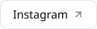</picture></a>
  <a href="https://www.youtube.com/@ZXCROBIN"><picture><source media="(prefers-color-scheme: dark)" srcset="assets/dark/btn-youtube.svg">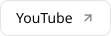</picture></a>
  <a href="https://www.tiktok.com/@zxc.robin"><picture><source media="(prefers-color-scheme: dark)" srcset="assets/dark/btn-tiktok.svg">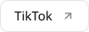</picture></a>

<picture><source media="(prefers-color-scheme: dark)" srcset="assets/dark/section-projects.svg">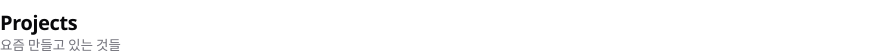</picture>

  <a href="https://github.com/Yoon-robin/RobinX"><picture><source media="(prefers-color-scheme: dark)" srcset="assets/dark/card-robinx.svg">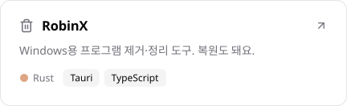</picture></a>
  <a href="https://github.com/Yoon-robin/RobinOS"><picture><source media="(prefers-color-scheme: dark)" srcset="assets/dark/card-robinos.svg"></picture></a>
  <a href="https://github.com/Yoon-robin/claude-humanizer"><picture><source media="(prefers-color-scheme: dark)" srcset="assets/dark/card-humanizer.svg"></picture></a>
  <a href="https://github.com/Yoon-robin/MIKAEL-Solutions"><picture><source media="(prefers-color-scheme: dark)" srcset="assets/dark/card-mikael.svg">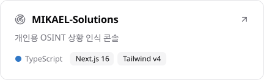</picture></a>
  <a href="https://mail.yoonrobin.xyz"><picture><source media="(prefers-color-scheme: dark)" srcset="assets/dark/card-robinmail.svg">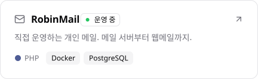</picture></a>
  <a href="https://github.com/Yoon-robin/RobinCloud"><picture><source media="(prefers-color-scheme: dark)" srcset="assets/dark/card-robincloud.svg">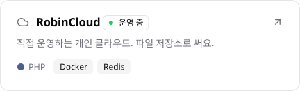</picture></a>
  <a href="https://yoonrobin.xyz"><picture><source media="(prefers-color-scheme: dark)" srcset="assets/dark/card-site.svg"></picture></a>
  <a href="https://itcsconnect.xyz"><picture><source media="(prefers-color-scheme: dark)" srcset="assets/dark/card-itcs.svg"></picture></a>

<picture><source media="(prefers-color-scheme: dark)" srcset="assets/dark/section-stack.svg"></picture>

<picture><source media="(prefers-color-scheme: dark)" srcset="assets/dark/stack.svg">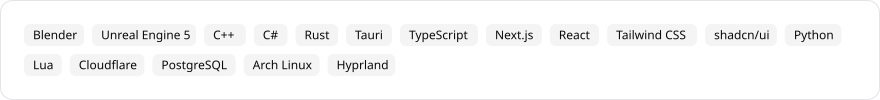</picture>
